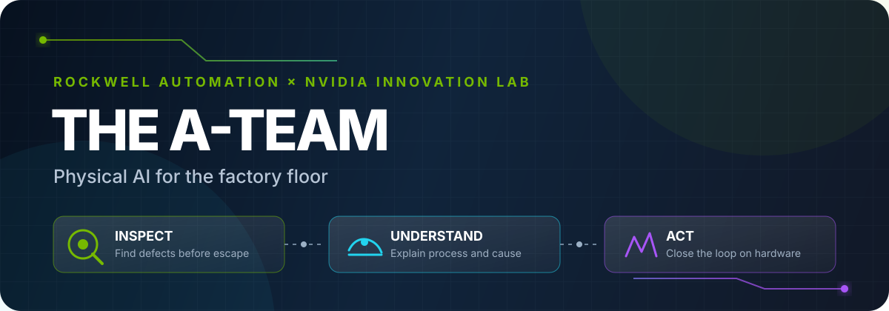
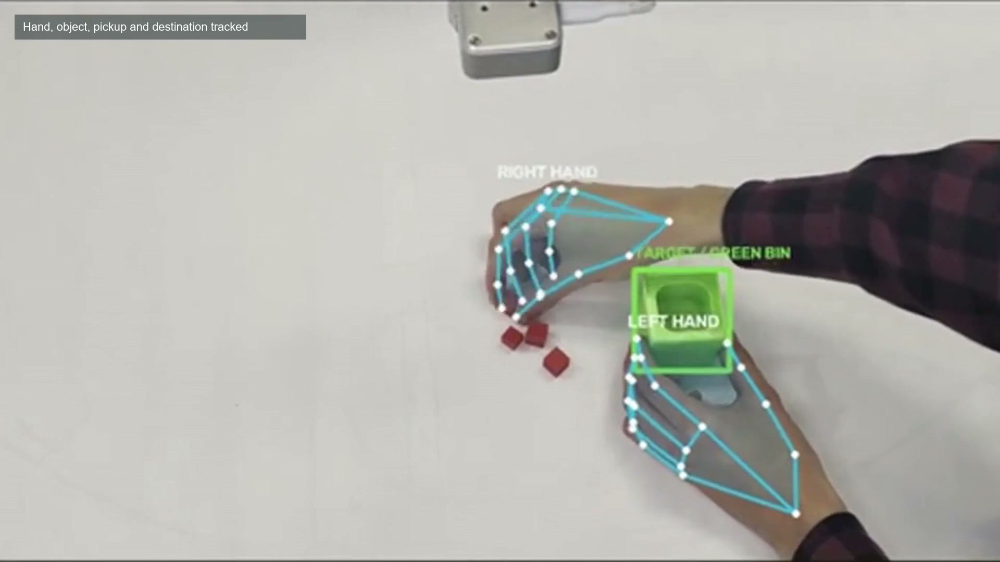
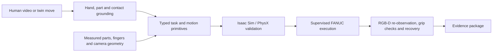
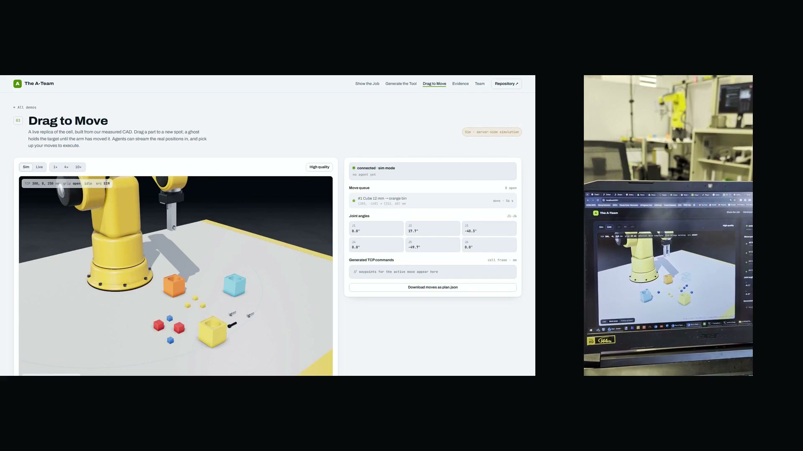
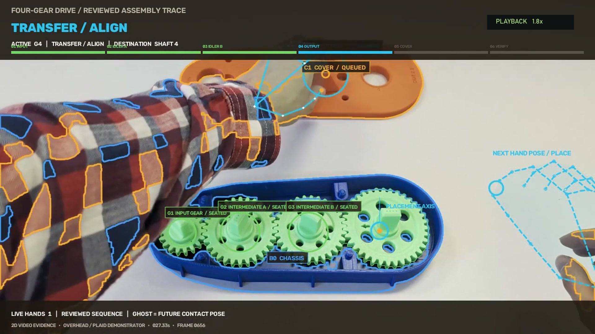
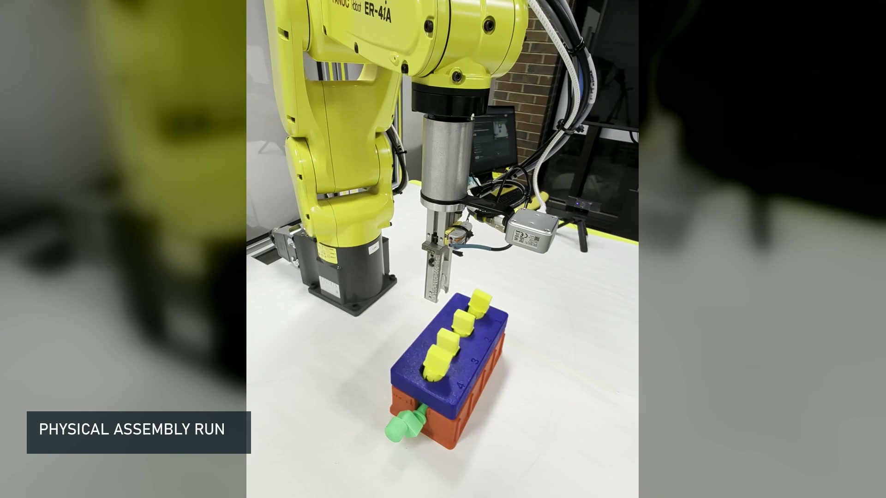
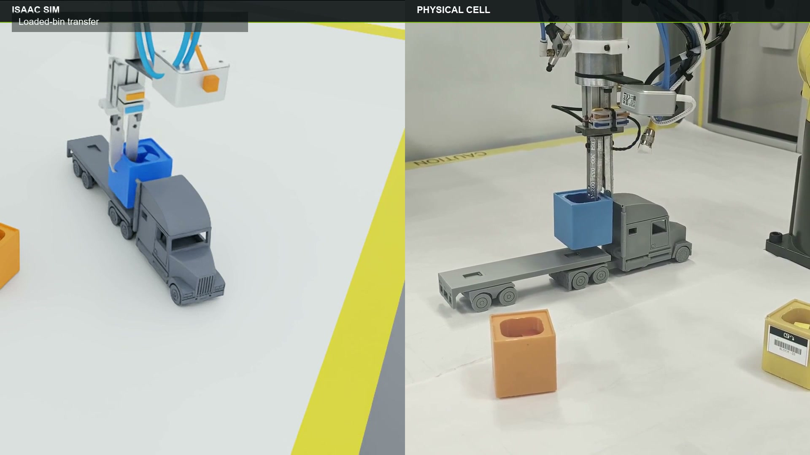
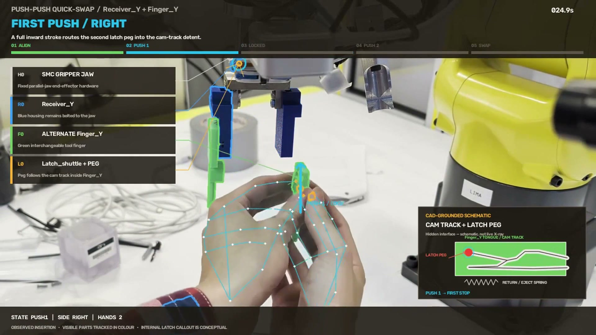
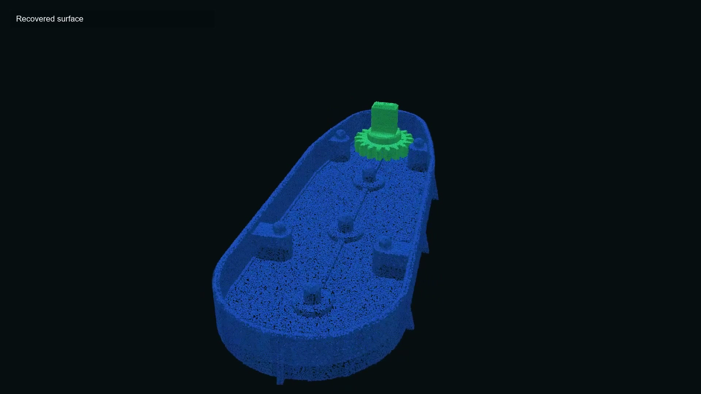

# Adaptive Workcell Reconfiguration

<p align="center">
  
</p>

<p align="center">
  <strong>Show a robot a new job, validate it in a digital twin, and turn the demonstration into reviewable machine actions.</strong>
</p>

<p align="center">
  <a href="https://youtu.be/5eQ3-p7v9-A">5-minute demo</a> ·
  <a href="https://www.theateam.dev/">interactive tools</a> ·
  <a href="docs/README.md">documentation</a> ·
  <a href="docs/reproduction.md">reproduce</a> ·
  <a href="results/README.md">evidence</a>
</p>

The A-Team built a Physical AI workflow for high-mix manufacturing. A human can demonstrate an assembly or arrange a task in a digital twin; the system extracts the relevant hand, part, contact, and placement events; grounds them in measured geometry; validates candidate motion in NVIDIA Isaac Sim; and produces a supervised plan for a FANUC ER-4iA.

This is a finished hackathon prototype, not a single-purpose sorter. The repository contains the control stack, observation-only benchmark, video-to-robot compiler, digital-twin planner, reconstruction experiments, printable CAD families, tests, and compact evidence used in the final submission.

## Why this matters

Robot cells are efficient after they have been engineered for a job. A new product or part variant can restart CAD cleanup, tooling selection, point teaching, collision review, and first-piece debugging. That delay is increasingly expensive when demand, suppliers, and product mixes change faster than conventional cell reconfiguration cycles.

Our objective was to preserve more of the knowledge in one human demonstration and make the resulting plan inspectable, revisable, and reusable. The prototype keeps a person in the approval loop and uses simulation as a risk-reduction layer rather than presenting simulation as proof of physical reliability.

<p align="center">
  
</p>
<p align="center"><em>A human demonstration is grounded into hand, object, pickup, and destination events.</em></p>

## System at a glance



| Capability | What is in this repository |
|---|---|
| **Video to robot** | Hand landmarks, object tracks, contact states, assembly timelines, a typed behavior tree, and robot-instruction schemas. [Read more](docs/video-to-robot.md) |
| **Perception and control** | Table/side/wrist RGB-D fusion, safety envelopes, phase control, gripper checks, active re-observation, and bounded recovery. [Read more](docs/perception-and-control.md) |
| **Simulation and evaluation** | A 48-candidate observation-only perception suite, randomized scenes, physics execution, scoring, and reproducible final reports. [Read more](docs/simulation-and-benchmarks.md) |
| **Robot-ready CAD** | Two- and four-gear assemblies, an inline-four demonstrator, a five-part badge, truck-task geometry, and quick-change finger concepts. [Browse CAD](cad/README.md) |
| **Reverse engineering** | Synthetic RGB-D and real RGB orbit pipelines with classical, neural, visual-hull, and geometry-evaluation tools. [Read more](docs/reverse-engineering.md) |
| **Digital twin control** | Drag-to-command planning, MCP integration, analytical reach checks, and generated TCP plans. [Browse app](apps/digital-twin/README.md) |

<p align="center">
  
</p>
<p align="center"><em>A drag-to-move plan is reviewed in the digital twin alongside the live physical cell.</em></p>

## Demonstrations

| Demonstration | Physical | Simulation | Repository evidence |
|---|:---:|:---:|---|
| Cubes into color-matched bins | yes | yes | [physical runs](docs/physical-experiments.md), [truck benchmark](results/truck-loading/) |
| Filled bins loaded onto a truck | supervised trials | yes | [final 6-run matrix](results/truck-loading/FINAL_REPORT.md) |
| Two-gear and four-gear assembly | supervised physical trials | yes | [CAD](cad/gearboxes/), [simulation demo](software/simulation-demos/gearbox/) |
| Inline-four engine demonstrator | partial supervised assembly | yes | [CAD](cad/engine/), [simulation demo](software/simulation-demos/engine-block/VALIDATION_SUMMARY.md) |
| Five-part Brewers badge | design artifact | yes | [CAD](cad/brewers-badge/), [simulation demo](software/simulation-demos/brewers-badge/) |
| Push-push interchangeable fingers | physical prototype | geometry checks | [tooling models and source](cad/quick-change-tooling/) |
| Object reconstruction from an orbit | physical capture | synthetic benchmark | [results](results/reverse-engineering/), [methods](software/reverse-engineering/) |
| Drag-to-command digital twin | yes, supervised | yes | [digital twin](apps/digital-twin/) |

See [Demonstrations and status](docs/demonstrations.md) for the exact evidence boundary behind each row.

<p align="center">
  
</p>
<p align="center"><em>The reviewed four-gear trace preserves part identities, assembly state, and the next intended placement.</em></p>

## Results snapshot

### Physical evidence

- Ten approved robot-access runs were documented from October 20–31, 2026.
- Seven complete three-camera exports contain 23 recordings, 142,335 timestamped robot state/action rows, 237.5 minutes of robot operation, and 69 table/side/wrist videos (11.9 camera-hours).
- The organizer-scored wall-grasp test produced a successful bin lift. A later supervised window completed four consecutive cube-to-bin transfers.
- Physical trials also recorded loaded-bin transport and multi-part assembly, including failures and operator corrections. Those are engineering evidence, not a production reliability claim.

<p align="center">
  
</p>
<p align="center"><em>The FANUC assembles the printed inline-four demonstrator using top-access grasp features.</em></p>

### Simulation evidence

The final observation-only truck controller completed **6/6** independently randomized physics episodes, improving over the preceding controller's **3/6**. Every final successful run placed all **12/12 cubes** into their matching bins and all **3/3 bins** on the truck. The controller received RGB, depth, reported calibration, joint/gripper state, and timestamps; simulator object transforms remained evaluator-only.

<p align="center">
  
</p>
<p align="center"><em>The same loaded-bin transfer is rehearsed in Isaac Sim and then executed in the physical cell.</em></p>

The reliability improvement cost additional observation and recovery actions: mean perception latency increased from 274.8 ms to 1066.2 ms, mean actions from 157.3 to 174.0, and mean simulated motion time from 22.1 s to 28.9 s. Full metrics and the six episode records are in [results/truck-loading](results/truck-loading/).

<p align="center">
  
</p>
<p align="center"><em>The push-push receiver turns finger changes into a latch operation instead of a gripper rebuild.</em></p>

## Quick start

The hardware-free tests require Python 3.12 or newer.

```bash
python -m venv .venv
# Windows: .venv\Scripts\activate
# Linux/macOS: source .venv/bin/activate
python -m pip install -e "software/robot-control" pytest
python -m pytest software/robot-control/tests software/truck_benchmark/test_benchmark.py -q
```

Run the public-release integrity check:

```bash
python scripts/check_public_release.py
```

Isaac Sim experiments require NVIDIA Isaac Sim and the environment-specific setup described in [Reproduction](docs/reproduction.md). Physical motion additionally requires the approved CSI client, verified calibration, safety review, and operator authorization.

## Repository map

```text
apps/                 Digital-twin planning and integration boundary
cad/                  Printable assemblies, task geometry and tool concepts
docs/                 Architecture, methods, experiments, limits and reproduction
media/                Small representative images only
results/              Compact reports, metrics, plans and selected reconstructions
software/             Robot control, benchmarks, video compiler and simulation demos
scripts/              Release-integrity and maintenance checks
```

Raw camera recordings, voice recordings, browser profiles, credentials, generated frame caches, cloned upstream models, and multi-gigabyte reconstruction workspaces are intentionally not committed. [Data and evidence](docs/data-and-evidence.md) explains what is preserved and how claims map to artifacts.

<p align="center">
  
</p>
<p align="center"><em>A wrist-camera orbit is fused into recovered surface geometry when usable CAD is missing.</em></p>

## Safety and limits

This repository does not bypass the robot controller, safety system, or CSI operator process. Plans are drafts until a qualified operator approves them. The prototype remains calibration-dependent; assemblies near 0.5 mm tolerance need better depth and metrology than the tested cameras consistently provided. Simulation reduces risk but does not reproduce every pneumatic, friction, compliance, exposure, or contact effect. See [Limitations](docs/limitations.md).

## Team

**The A-Team:** Abdallah Benelmadjat (team lead), Pablo Camarillo, Benjamin Hess, Tar Meh, and Nathan Baker.

Built and tested at the UWM Connected Systems Institute/SIDC Lab for the MSOE AI Club Rockwell Automation + NVIDIA Hackathon. See [Credits and third-party notices](docs/credits.md).

