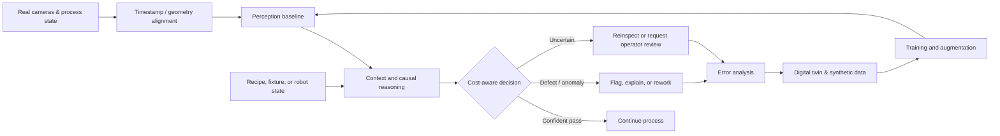
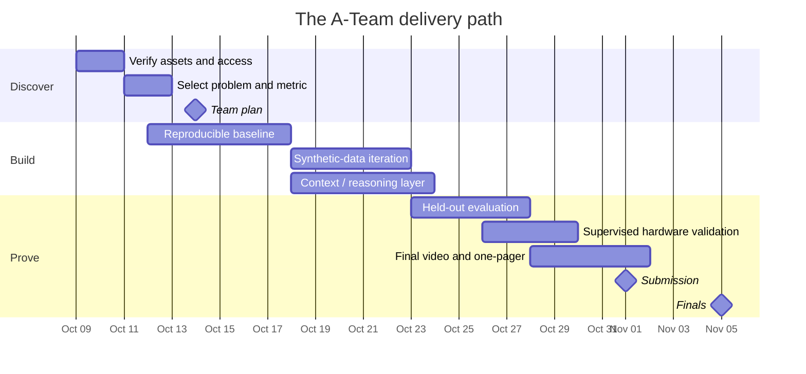

<div align="center">


<br />

[](#the-challenge)
[](#our-engineering-thesis)
[](#execution-roadmap)
[](#the-a-team)

**An evidence-first Physical AI project for safer, more adaptive, and more trustworthy manufacturing.**

[Mission](#mission) · [Experiments](#three-experiments-one-decision) · [Architecture](#reference-architecture) · [Evaluation](#how-we-will-measure-success) · [Roadmap](#execution-roadmap) · [Knowledge Base](#knowledge-base)

</div>

---

## Mission

The A-Team is competing in the **Rockwell Automation + NVIDIA Innovation Lab Fall 2026**, a four-week Physical AI hackathon organized with the **MSOE AI Club** and **UWM Connected Systems Institute (CSI)**.

Our goal is not to build a model that looks impressive on a laptop. We are building toward a system that:

1. solves a verified manufacturing pain point;
2. operates on or meaningfully supports real equipment;
3. improves a measured baseline;
4. explains what it sees and where it can fail;
5. respects plant safety and existing control boundaries; and
6. can plausibly transfer beyond one clean demonstration.

> **Our standard:** inspect the real process, understand the cause, act safely, and prove the result.

## The challenge

CSI operates a high-mix, low-volume pilot manufacturing environment built with Rockwell Automation technology. The line produces vials containing stacked components or mixed-color liquids, while a separate FANUC cell supports grasping and sorting experiments. Teams can combine real evaluation data, digital twins, synthetic-data generation, NVIDIA compute, and sponsor mentorship.

The final system should address one of three real experiments:

| Experiment | Operational question | Primary output | Hardest constraint |
|---|---|---|---|
| **1 · Final Vial Inspection** | Did a visible defect or missed placement escape the existing inspection process? | Defect class and fixture-level decision | Rare defects, transparency, glare, fill-state context |
| **2 · Fluid Mixing Station 3** | Does the vial match its recipe, and what process state likely caused a mismatch? | Anomaly, cause, and transition risk | Only 30 labeled vials; synchronized causal context |
| **3 · Grasping and Sorting** | Can the robot find, grasp, place, and recover under variation? | Safe closed-loop robot action | Calibration, sim-to-real transfer, physical access |

Read the full evidence-backed analysis in **[Three Experiments: Dataset & Validation Strategy](knowledge-base-kickoff/THREE_EXPERIMENTS_DATASET_STRATEGY.md)**.

## Our engineering thesis

Winning will require more than peak aggregate accuracy. Manufacturing errors have unequal costs: an escaped defect can be far more damaging than a good part sent for reinspection. A useful system must therefore combine **perception**, **process context**, **cost-aware decisions**, and **operator trust**.

We will optimize for five properties:

- **Grounded:** every feature maps to a real workflow or failure mode.
- **Measurable:** every claim has a baseline, metric, and held-out test.
- **Context-aware:** recipe order, fixture sequence, camera timing, and prior state matter.
- **Safe:** AI remains outside protected PLC, safety, and control boundaries unless explicitly supervised.
- **Deployable:** latency, legacy equipment, calibration, and operator interpretation are first-class requirements.

## Three experiments, one decision

### Experiment 1 — Final Vial Inspection

Two 30-position fixtures receive accepted and scrapped vials. The overhead system must identify `pass`, `missing_cap`, `crooked_cap`, `damaged_vial`, and `no_vial` at a numbered target aperture. Because fixtures fill in a known sequence, an empty position is not automatically a defect.

**Fastest defensible baseline**

- Reconstruct all 60 fixture targets from the provided coordinates.
- Generate labeled synthetic examples for every class and position.
- Train a compact crop-level classifier or Visual ChangeNet baseline.
- Add a fixture-level state machine using placement count or order completion.
- Evaluate on untouched real scenes with per-class recall and explicit escaped-defect counts.

**Why it is currently our recommended starting point:** the target is clear, the supporting assets are mature, the evaluation is defensible, and a baseline can be built early enough to leave time for synthetic-to-real iteration.

### Experiment 2 — Fluid Mixing Station 3

Three usable tanks feed one shared mixing path. Residual liquid from the previous recipe can discolor the first vial after changeover. A useful system must connect synchronized visual evidence to recipe order, tank state, dispense sequence, and carryover—not merely report that a color looks unusual.

**Strongest differentiated baseline**

- Align `tank_level`, `vial_fill`, and `cap_seal` by timestamp.
- Measure vial color and fill using transparent-container-aware image processing.
- Use the last vial of a recipe as its clean reference.
- Predict risky transitions from previous/current recipe and dispense order.
- Evaluate anomaly detection and causal explanation separately using leave-one-recipe-out testing.

**Why it is compelling:** it supports a sophisticated multimodal story—detect, explain, and potentially warn before the next bad fill—but demands careful validation because only 30 vials are labeled.

### Experiment 3 — Grasping and Sorting

A FANUC ER-4iA, SCHUNK pneumatic gripper, two overhead cameras, and a wrist camera create a full closed-loop robotics task. The real objective is repeatable performance under variation, not one scripted successful pick.

**Minimum credible baseline**

- Make the supplied object and fingers work reliably in simulation.
- Validate camera-to-robot calibration and pose estimation.
- Measure repeated picks across randomized starting positions.
- Move one source of variation at a time into the test.
- Compare simulation with supervised physical trials.
- Add re-observation and safe retry after a failed or uncertain grasp.

**Why it is high-risk/high-reward:** it offers the most dramatic live demonstration, but integration, calibration, asset availability, and testbed scheduling can consume the project window.

## Reference architecture



This is a reference pattern, not a commitment to unnecessary complexity. We will begin with the smallest useful baseline and add reasoning, simulation, or automation only when an observed failure justifies it.

## How we will measure success

### Evaluation rules

- Keep a fixed, untouched test set.
- Split by scene, production run, recipe, or trial—not by nearly identical neighboring frames.
- Report per-class and per-condition results, not only one aggregate number.
- Separate false alarms from missed defects.
- Measure explanation/cause accuracy separately from detection.
- Report inference latency and hardware assumptions.
- Show representative successes **and** failures.
- Record model version, data version, threshold, random seed, and simulation settings.

### Shared scorecard

| Dimension | Evidence we expect |
|---|---|
| **Technical** | Held-out metrics, confidence intervals where possible, latency, ablations |
| **Operational** | Workflow integration, decision threshold, fail-safe behavior |
| **Business** | Scrap, rework, downtime, labor, changeover, or quality impact |
| **Generalization** | New recipe, new position, lighting shift, or unseen object test |
| **Trust** | Interpretable result, uncertainty path, visible failure analysis |
| **Deployment** | Hardware/runtime assumptions and legacy-system considerations |

## Data discipline

The event specifically asks teams to inspect real data but generate training data with the provided digital twins. We will treat real-line samples as evaluation and domain-understanding evidence unless organizers explicitly approve another use.

Our minimum provenance record will include:

- source and license/usage restriction;
- real versus synthetic origin;
- generator/twin version and parameters;
- label-generation method;
- train/validation/test assignment;
- augmentation history; and
- known visual or simulation gaps.

No model result is credible if the same scene, production sequence, or near-duplicate frames leak across the split.

## Execution roadmap



The photographed kickoff slide listed October 13 for the initial plan, while the current event workspace and article list **October 14 at 11:59 PM CT**. The workspace and `#hackathon-announcements` are the operational source of truth.

## The A-Team

| Member | Role in workspace | Initial responsibility |
|---|---|---|
| **Abdallah Benelmadjat** | Lead | Product direction, integration, repository quality |
| **Pablo Camarillo** | Participant | To be assigned during experiment selection |
| **Benjamin Hess** | Participant | To be assigned during experiment selection |
| **Tar Meh** | Participant | To be assigned during experiment selection |
| **Nathan Baker** | Participant | To be assigned during experiment selection |

Responsibilities will be converted into named owners after the data-access audit. We prefer explicit ownership of data, modeling, hardware/integration, evaluation, and presentation over everyone working on everything.

## Knowledge base

The kickoff has been converted into a searchable evidence package:

| Entry | What it contains |
|---|---|
| **[Kickoff brief](knowledge-base-kickoff/THE_A_TEAM_KICKOFF_REPORT.md)** | Executive summary, resources, rules, deliverables, deadlines, and immediate actions |
| **[Three-experiment strategy](knowledge-base-kickoff/THREE_EXPERIMENTS_DATASET_STRATEGY.md)** | Dataset structure, hypotheses, baselines, risks, validation plans, and selection gate |
| **[Complete transcripts](knowledge-base-kickoff/ALL_TRANSCRIPTS.md)** | Timestamped machine transcription of all eight kickoff recordings |
| **[Photo context](knowledge-base-kickoff/ALL_IMAGE_CONTEXT.md)** | Detailed interpretation of all 27 photographed slides |

Machine transcripts are working notes, not quote-ready records. Check the source recording before attributing exact wording to a speaker.

## Repository map

```text
.
├── assets/
│   └── a-team-hero.svg
├── knowledge-base-kickoff/
│   ├── ALL_IMAGE_CONTEXT.md
│   ├── ALL_TRANSCRIPTS.md
│   ├── THE_A_TEAM_KICKOFF_REPORT.md
│   └── THREE_EXPERIMENTS_DATASET_STRATEGY.md
└── README.md
```

Project code, experiment configurations, tests, model cards, and result artifacts will be added only after the dataset-selection gate so the repository structure reflects the chosen problem rather than assumptions.

## Working agreement

1. Open an issue for every experiment or decision.
2. Define the hypothesis, metric, dataset version, and expected artifact before implementation.
3. Keep pull requests small enough to review and reproduce.
4. Never commit credentials, private datasets, model secrets, or restricted plant information.
5. Include tests or a reproducible evaluation command with every modeling change.
6. Record failed experiments; negative evidence prevents repeated work.
7. Do not send commands to physical equipment or alter control/safety systems without the plant manager and assigned mentor.

## Definition of done

We are done when another engineer can clone the repository, reproduce the baseline, understand the data lineage, run the final evaluation, see the system operate on supervised real hardware, and explain both where it works and where it does not.

---

<div align="center">

**The A-Team** · MSOE AI Club × UWM CSI × Rockwell Automation × NVIDIA<br>
*Build the smallest system that proves the biggest manufacturing value.*

</div>
