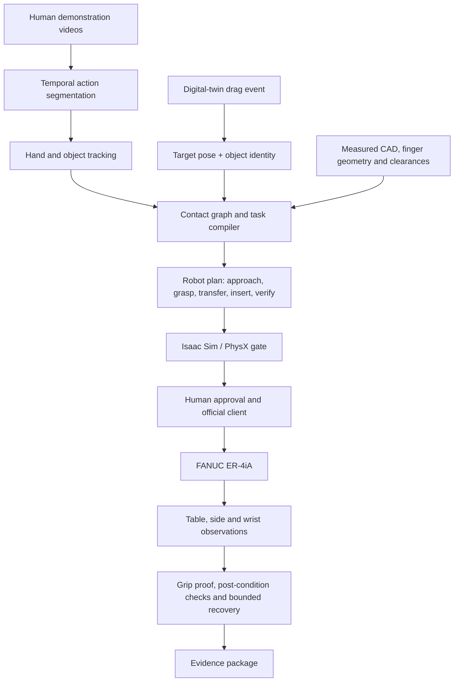

# Architecture

**Status:** implemented prototype with physical and simulated demonstrations  
**Scope:** human demonstration or digital-twin intent through supervised robot execution  
**Evidence:** [demonstrations](demonstrations.md), [results](../results/README.md)  
**Limit:** the physical execution path remains operator-approved and calibration-dependent

## Design principle

The project separates evidence extraction, geometric grounding, planning, execution, and evaluation. A language or vision model can propose structure, but it does not get an unrestricted path to robot motion. Each boundary emits inspectable data that another component can validate.

## Component boundaries

| Layer | Input | Output | Implementation |
|---|---|---|---|
| Demonstration grounding | phone video or calibrated camera stream | hand landmarks, object masks, action intervals | [`software/video_to_robot`](../software/video_to_robot/) |
| Task compilation | grounded observations + known task geometry | contact graph, behavior tree, robot task JSON | [`results/video-to-robot/compiled_task`](../results/video-to-robot/compiled_task/) |
| Perception | table, side, wrist RGB/RGB-D + calibration | metric candidate poses and confidence | [`software/robot-control`](../software/robot-control/) |
| Planning and recovery | object poses, gripper state, safety envelope | phase-aware TCP or joint commands | [`software/robot-control/robot_control`](../software/robot-control/robot_control/) |
| Evaluation | observation-only predictions or completed physics state | accuracy, task completion, latency, action and path metrics | [`software/truck_benchmark`](../software/truck_benchmark/) |
| Digital twin | drag events + cell model | reachable TCP plan and queue | [`apps/digital-twin`](../apps/digital-twin/) |
| Reconstruction | camera orbit, optional depth or pose priors | mesh/point cloud + geometry scores | [`software/reverse-engineering`](../software/reverse-engineering/) |

## Safety boundary

The generated plan is not a robot authorization. The physical path requires:

1. an approved session and official client;
2. verified work frame, tool frame, table plane, TCP, and finger geometry;
3. reach and workspace checks;
4. a high-clearance approach;
5. operator review before risky descents; and
6. proof-lift and retreat logic before loaded transport.

The simulation benchmark enforces a separate information boundary. Policy code cannot access simulator object transforms or evaluator labels. Ground truth is used only to create randomized scenes and score the final state.

## Why the system is hybrid

No single model owned every decision reliably. RGB was useful for identity and residual proposals. Depth supplied metric height and table-relative geometry. Known CAD constrained expected size and grasp corridors. The wrist view reduced local uncertainty. Deterministic state machines made contact, retry, and abort rules auditable. This combination outperformed a monolithic perception-to-action approach in the tested task.

[Back to documentation](README.md)

