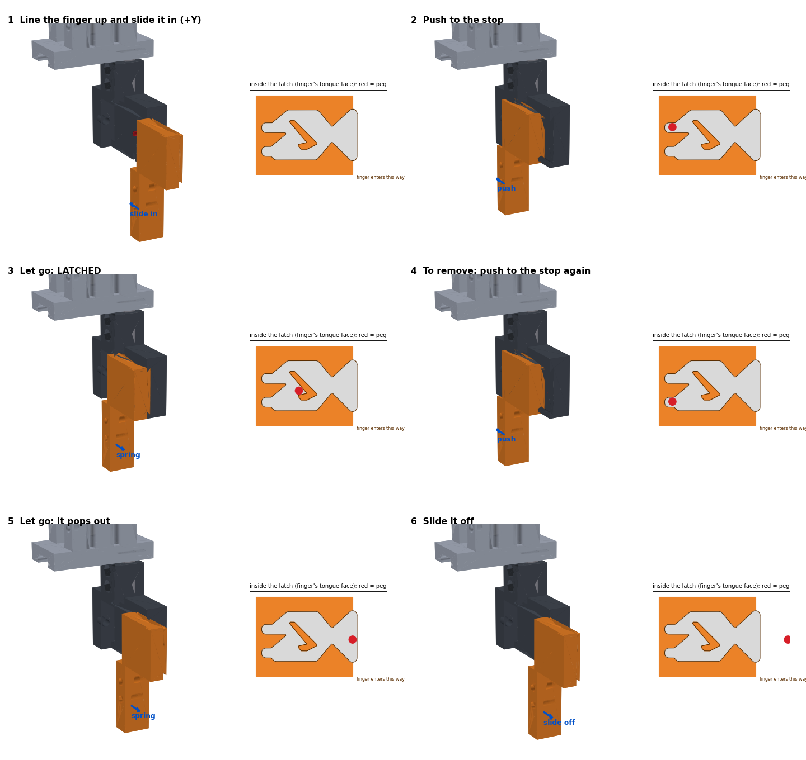

# CAD and tooling

**Library:** [`cad/`](../cad/README.md)  
**Design objective:** top-down robotic assembly with generous lead-ins and standardized grasp interfaces

## Robot-ready design rules

The demonstrators were designed around the installed fingers, approximately 76 × 12 × 6 mm each. Their open inside gap tapered from about 15 mm near the upper gripping area to 18 mm at the tips.

Common grasp-interface defaults:

| Parameter | Nominal value |
|---|---:|
| Tab width | 16 mm |
| Tab thickness in closing direction | 8 mm |
| Usable tab height | 14 mm |
| Top lead-in chamfer | 1.5–2 mm |
| Clear approach corridor | at least 34 × 20 mm |
| Shaft/bore diametral clearance | about 0.6 mm |
| Cover locating radial clearance | about 0.5 mm |

Additional rules:

- vertical-only placement where possible;
- stable tab-up staging before pickup;
- tapered shaft tips and bore funnels;
- coarse gears with visible seating;
- no press fits, tiny fasteners, sideways insertion, or forceful operations;
- separate assembly orientation from print orientation; and
- parametric dimensions for future gripper changes.

## CAD families

### Two-gear gearbox

A base, two identical gears, and a drop-on cover. It established the grasp tab, tapered shafts, generous running clearance, and visible mesh inspection used by later parts. Both printable 3MF and simulation-friendly STL files are included.

### Four-gear gearbox

A more complex printed assembly with four unique gear pieces, enlarged during the physical build. The exact applied physical scale was not conclusively verified, so repository files are labeled as nominal CAD rather than physical metrology.

### Inline-four engine

A block, crankshaft, cover, head, four rods, and four pistons designed for vertical drops. The physical print used a 220% scale. The asset manifest records per-part hashes and geometry checks.

### Five-part Brewers badge

A display stand, base, glove emblem, rim/detail carrier, and nameplate with robot grasp fins. It is a regional demonstration asset; team affiliation does not imply endorsement by the Milwaukee Brewers or Major League Baseball.

### Quick-change tooling

The push-push concept uses a receiver, shuttle, and replaceable tips so a finger can latch on the first push and release on a second push. The repository includes the current Y-orientation receiver/shuttle, rack concepts, engineering tips, generation scripts, and geometry checks. It remains a prototype and requires retention-force, fatigue, sensing, contamination, and safety qualification before industrial use.

## Printing and fit

Print a fit coupon before a full base when possible. Inspect elephant-foot compensation, shaft diameter, bore roundness, and tab thickness. Do not infer physical coordinates from slicer scale or nominal CAD alone. Measure the printed assembly and update the workcell model.

## File formats

- `3MF` retains the printable scene and units.
- `STL` supports simulation and broad slicer compatibility.
- `STEP` is provided for editable/mechanical exchange where available.

See each folder README for scale, provenance, and known limitations.

[Back to documentation](README.md)

