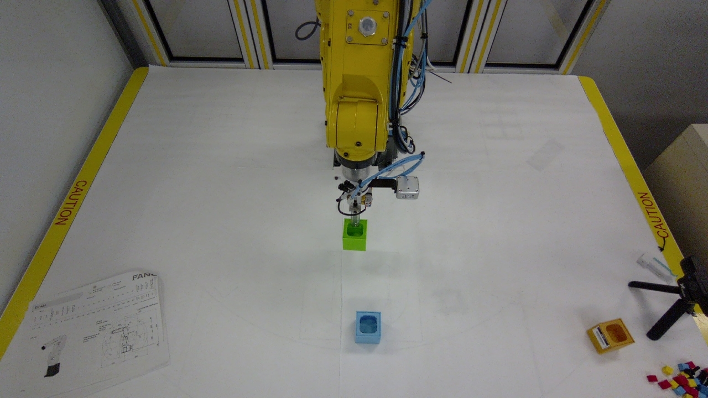

# Physical experiments

**Workcell:** FANUC ER-4iA with SMC pneumatic parallel gripper  
**Site:** UWM Connected Systems Institute/SIDC Lab  
**Period:** October 20–31, 2026  
**Control:** approved sessions, official interface, supervised execution

## Archive scope

The project archive documents ten approved robot-access runs. Seven complete three-camera exports contain:

| Item | Count |
|---|---:|
| Retained recordings | 23 |
| Timestamped state/action rows | 142,335 |
| Robot operation | 237.5 minutes |
| Table/side/wrist videos | 69 |
| Aggregate camera footage | 11.9 hours |

Each complete record links joint and gripper state, tool position, commanded actions, timing, and synchronized camera views. Three additional sessions retain partial requests, plans, logs, or snapshots. Raw recordings include facility context and are not placed in this public repository.

## Progression

1. **Point-to-point commissioning.** Verify home, reach envelope, work frame, and the execution boundary.
2. **Wall grasp.** Measure the open finger gap and bin wall geometry; establish a shallow close and proof lift.
3. **Cube placement.** Use the table view for inventory and wrist re-centering before descent.
4. **Loaded bins.** Reserve finger corridors, prove contact, raise in stages, and pivot about the bin center.
5. **Gear assemblies.** Use CAD as a nominal reference, then correct scale and placement from the physical parts.
6. **Engine demonstrator.** Apply the same vertical-drop primitives to more parts and tighter grasp fins.
7. **Digital twin control.** Convert drag targets into queued, inspectable TCP commands.

## Physical evidence retained in the submission

- The organizer-scored one-wall bin test achieved a successful lift.
- A later supervised reviewed window completed four consecutive cube-to-bin transfers.
- Multi-view footage and telemetry preserve loaded-bin transport and multi-part placement trials.
- Failures were retained during development: off-center grasps, CAD-to-print scale mismatch, excessive descent, collisions, dropped objects, and operator corrections.

## Highest-value lessons

### Nominal CAD is not physical metrology

The four-gear print and engine demonstrator were enlarged from their nominal models. Using unscaled CAD targets led to wrong insertion locations. Physical scale, landmarks, and final bore/shaft positions must be measured before execution.

### Approach corridors must model the complete finger

Checking only the inside jaw gap misses collisions by the 76 × 12 × 6 mm finger bodies. Every grasp tab therefore reserves a vertical corridor around the full fingers, not only the object between them.

### Depth must be table-relative

Referencing depth to the table plane makes small parts separable. A floor reference or incorrect range hides the relevant height differences.

### Close commands need state

Repeated open/close commands and rapid micro-corrections caused undesirable motion. Phase latching, command debouncing, completion conditions, and larger monotonic segments made behavior more stable.

### A proof lift is cheaper than a failed transfer

After closing, lift only a few millimeters, dwell, confirm jaw gap/contact, then proceed. The final simulator controller encodes this lesson explicitly.

## Safety note

The public code is an engineering prototype. Do not replay recorded positions on another cell. Coordinate frames, tool geometry, calibration, limits, and obstacle layouts are installation-specific.

[First physical run](experiments/first-physical-run.md) · [Back to documentation](README.md)

