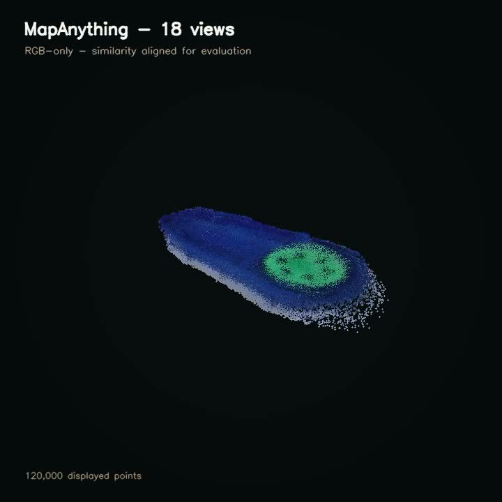

# Reverse engineering from robot-camera orbits

**Synthetic benchmark source:** [`software/reverse-engineering/synthetic`](../software/reverse-engineering/synthetic/)  
**Physical orbit source:** [`software/reverse-engineering/physical-orbit`](../software/reverse-engineering/physical-orbit/)  
**Selected outputs:** [`results/reverse-engineering`](../results/reverse-engineering/)

## Question

Can an eye-in-hand robot orbit an unfamiliar part and recover useful 3D geometry without giving the reconstruction algorithm the reference CAD?

Two tracks answered different parts of that question:

1. **Synthetic RGB-D benchmark.** Isaac Sim captured controlled orbits from known camera poses. Reconstruction code received RGB, noisy depth, and reported poses; evaluator CAD remained hidden until scoring.
2. **Physical RGB orbit.** The FANUC wrist captured a real upper-hemisphere orbit. Methods received RGB and, in separately labeled variants, robot pose priors. No depth was available for the final RGB-only comparison.

## Methods evaluated

- multi-view TSDF and depth fusion;
- pose refinement and pose-graph optimization;
- Poisson surface reconstruction;
- visual hull / silhouette carving;
- dual-pass and table-plane closure variants;
- next-best-view logic;
- classical photogrammetry;
- transformer-based multi-view point reconstruction;
- neural implicit surface experiments; and
- Gaussian/surface representations where dependencies were available.

Dependency failures were recorded separately from method failures. A model that could not be installed or whose checkpoint was unavailable was not assigned a fabricated experimental score.

## Evaluation

Candidate geometry was frozen before the measured reference was exposed. Offline scoring then used similarity alignment followed by bidirectional surface distance, completeness, percentile error, F-score, extent error, topology, and watertightness.

The selected physical-orbit point cloud contains 314,522 vertices. After post-hoc similarity alignment for evaluation, it measured:

| Metric | Value |
|---|---:|
| Symmetric Chamfer mean | 2.85 mm |
| F-score at 2 mm | 0.587 |
| F-score at 5 mm | 0.857 |
| Runtime recorded by method | 38.0 s |

The scale and alignment were evaluation transforms, not recovered physical metrology. The physical orbit observed only the upper surface, so the output is a point cloud rather than a certified watertight CAD solid.

## Practical conclusion

Robot-camera orbits can generate useful reference geometry for visualization, rough collision models, and downstream CAD work. They did not produce metrology-grade models of hidden faces or tight mating features in this experiment. Better lighting, synchronized pose capture, calibrated depth, a second flipped pass, and scale markers would materially improve the result.

[Back to documentation](README.md)

