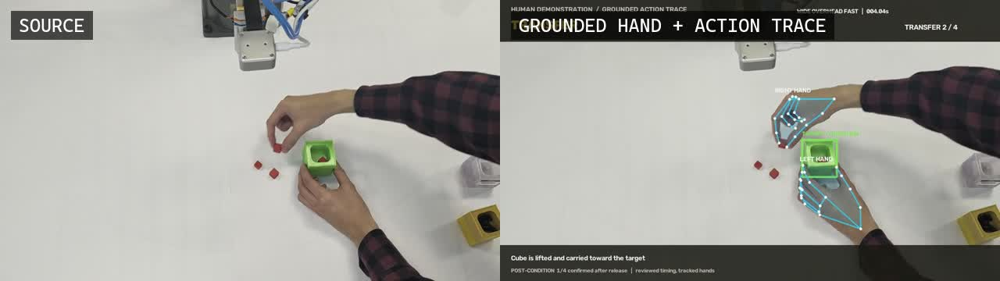

# Video-to-robot evidence compiler

**Status:** working offline pipeline  
**Input:** short human assembly demonstrations  
**Output:** annotated media, observations, contact timeline, behavior tree, and robot-oriented task JSON  
**Source:** [`software/video_to_robot`](../software/video_to_robot/)  
**Evidence:** [`results/video-to-robot`](../results/video-to-robot/)

## What the pipeline does

The compiler intentionally separates what is visible in the video from what must come from calibrated workcell geometry.

1. Decode the source at its native timing.
2. Track 21-point hands and known parts.
3. Use velocity, distance, overlap, and hysteresis to infer approach, contact, transfer, insertion, and release intervals.
4. Preserve persistent part IDs and confidence in an annotation package.
5. Compile a contact graph and behavior tree.
6. Add robot-frame positions only after camera calibration, depth, CAD, or a verified digital-twin transform is available.
7. Render annotations without modifying the source media.

## Why not ask one video model for the full trajectory?

Uniform frame sampling can miss brief contact events. A fluent description can also hide uncertainty about millimeter-scale seating, tool clearance, or whether a part was actually grasped. The pipeline therefore uses explicit temporal windows and geometry-aware post-conditions, then stores the evidence behind each action.

The default implementation combines:

- MediaPipe hand landmarks;
- deterministic segmentation for known demonstration parts;
- a hysteretic contact-state machine;
- cross-take consensus;
- typed JSON schemas; and
- a renderer that keeps the original audio and duration.

A different mask tracker can replace the segmentation layer without changing the evidence schema.

## Compiled artifacts

| Artifact | Purpose |
|---|---|
| `robot_task.json` | ordered skills, parameters, post-conditions, and evidence scope |
| `contact_graph.json` | parts, contacts, ordering, and dependencies |
| `behavior_tree.json` | executable control structure with verification and recovery branches |
| `INSTRUCTION_CARD.md` | human-readable assembly summary |
| annotation JSON | frame/time intervals and part/hand observations |

## Scope boundary

The original phone clips were sequential takes, not synchronized calibrated views. They support reliable 2D tracking and temporal action extraction. They do not independently provide metric 6D trajectories or sub-millimeter insertion tolerances. Those require synchronized camera geometry, depth or multi-view triangulation, known CAD, and a robot/workcell transform.

## Reproduce

See the portable command sequence in [Reproduction](reproduction.md). The hand-landmark task file is not vendored; obtain it from the official MediaPipe model distribution.

[Back to documentation](README.md)

